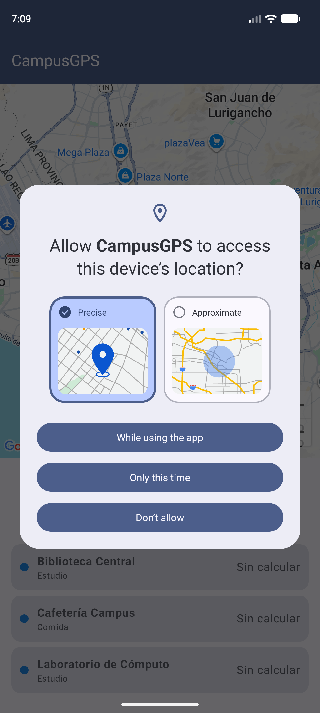
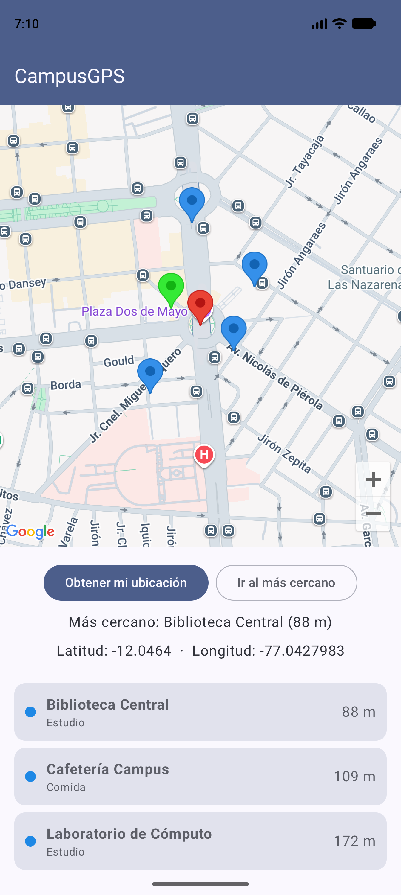
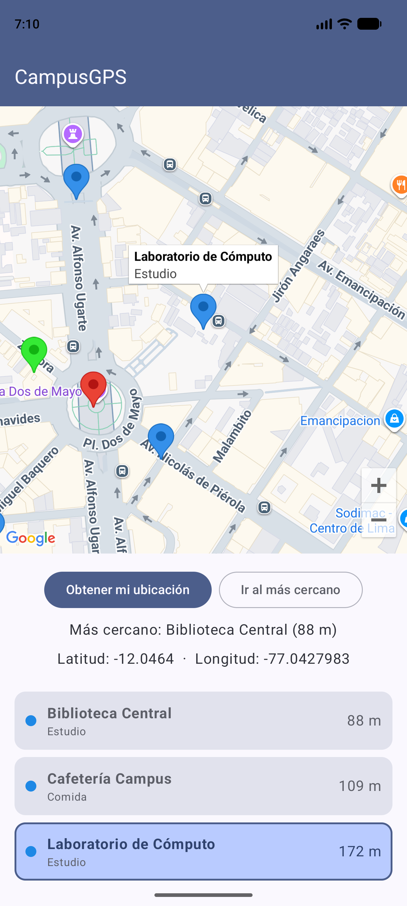
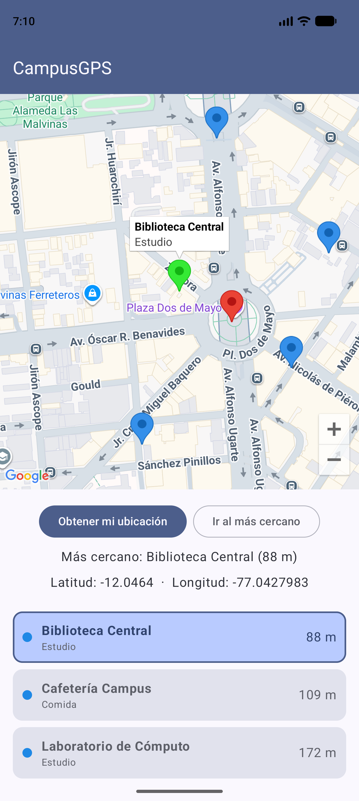
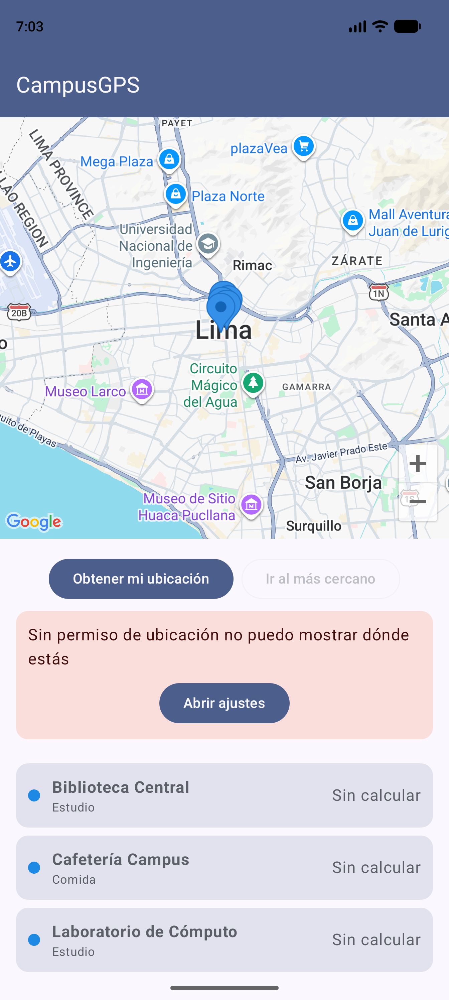

# CampusGPS

App Android que obtiene la ubicación del celular, la muestra en un mapa y dice qué lugar del campus tienes más cerca.

**Tecnología:** Kotlin + Jetpack Compose + Material 3, Google Play Services Location y Maps Compose.
**Patrón:** MVVM + Repository (con interfaces).

## Descripción

CampusGPS pide el permiso de ubicación, obtiene tu posición con `FusedLocationProviderClient` y la dibuja en un mapa de Google. Muestra 5 lugares ficticios del campus (biblioteca, cafetería, laboratorio, auditorio y estacionamiento) con su distancia en metros, ordenados del más cercano al más lejano. El más cercano se marca en verde y hay un botón para ir hasta él.

La app sigue funcionando si el usuario niega el permiso, apaga el GPS o no tiene Google Play Services: cada caso muestra un mensaje claro con una acción útil.

## Cómo ejecutarla

1. Abre el proyecto en Android Studio y sincroniza Gradle.
2. En `local.properties` agrega tu clave de Google Maps (este archivo **no se sube** a GitHub):

   ```
   MAPS_API_KEY=tu_clave_aqui
   ```

3. Usa un emulador con Google Play y pon su ubicación en `-12.0464, -77.0428` (tres puntos → Location).

## Estructura de paquetes

```
com.flores.campusgps/
├── MainActivity.kt
├── model/
│   └── Modelos.kt                 Posicion, Lugar, LugarConDistancia, UbicacionUi, TipoError
├── data/
│   ├── UbicacionRepository.kt     interface (+ GpsApagadoException)
│   ├── UbicacionRepositoryGoogle.kt   implementación con FusedLocationProviderClient
│   ├── LugaresRepository.kt       interface
│   └── LugaresRepositoryLocal.kt  los 5 lugares fijos
├── util/
│   ├── Distancia.kt               distanciaMetros()
│   └── Formato.kt                 formatearDistancia()
├── viewmodel/
│   ├── MapaViewModel.kt           estado, distancias, selección y más cercano
│   └── CampusViewModelFactory.kt
└── ui/
    ├── PantallaMapa.kt            pantalla principal y permiso en tiempo de ejecución
    ├── MapaUbicacion.kt           mapa y marcadores
    ├── ListaLugares.kt            lista de tarjetas
    ├── MensajeError.kt            errores con su botón
    └── theme/
```

## Arquitectura MVVM + Repository

```
View (PantallaMapa)
   |  evento: pulsar el botón        ^  collectAsState()
   v                                 |
ViewModel (MapaViewModel)  --- StateFlow --->
   |  llama a las interfaces
   v
UbicacionRepository  ---> UbicacionRepositoryGoogle (FusedLocationProviderClient)
LugaresRepository    ---> LugaresRepositoryLocal (los 5 lugares fijos)
```

| Capa | Conoce a | No debe |
|---|---|---|
| View (`ui/`) | Solo a su ViewModel | Usar un Repository, `FusedLocationProviderClient` ni calcular distancias |
| ViewModel | Solo a las interfaces de Repository | Conocer Composables ni recibir un `Context` |
| Repository | Google Play Services (en la implementación) | Exponer clases de UI |
| `util/` | Funciones puras (distancia, formato) | Guardar estado |

## Capturas

| Permiso | Mapa con mi ubicación |
|---|---|
|  |  |

| Marcadores de los lugares | Lista ordenada y más cercano |
|---|---|
|  |  |

| Error (permiso denegado) |
|---|
|  |

## Para pensar

**1. ¿Por qué `FusedLocationProviderClient` está dentro del Repository y no en el ViewModel?**
Porque el ViewModel no debe conocer Google Play Services ni recibir un `Context`. El Repository esconde ese detalle detrás de una interfaz: el ViewModel solo pide `obtenerPosicion()`. Así se puede cambiar la implementación (o usar una falsa para probar) sin tocar el ViewModel, y se evitan fugas de memoria por guardar un `Context` en una clase que sobrevive a la pantalla.

**2. ¿Qué diferencia hay entre el permiso de ubicación y la clave de API de Maps? ¿Qué pasa si falta cada uno?**
El permiso lo concede el usuario y autoriza a la app a leer dónde está. La clave de API identifica a la app ante Google para poder descargar el mapa. Si falta el permiso, no hay ubicación: la app muestra el error con "Abrir ajustes", pero el mapa se ve. Si falta la clave (o es inválida), la ubicación funciona, pero el mapa sale en blanco sin calles ni marcadores.

**3. ¿Por qué la clave va en `local.properties` y no en el código? ¿Qué harías si se subiera a GitHub por error?**
Porque `local.properties` está en `.gitignore` y no se sube al repositorio. Si la clave estuviera en el código, cualquiera podría verla y usarla con la cuenta de quien la creó. Si se subiera por error, la borraría en Google Cloud, crearía una nueva (restringida al paquete y a la SHA-1), la guardaría en `local.properties` y revisaría el `.gitignore`, porque la anterior ya no es segura.

**4. ¿Dónde calculas la distancia y por qué no en el Composable?**
En el ViewModel (`actualizarDistancias`), usando la función pura `distanciaMetros` de `util/`. Un Composable se redibuja muchas veces y solo debe dibujar el estado que recibe. Si calculara distancias ahí, repetiría el trabajo en cada redibujado, mezclaría lógica con interfaz y rompería MVVM.

**5. ¿Qué pasa con tu app si el usuario niega el permiso dos veces? ¿Cómo lo manejas?**
Android deja de mostrar el cuadro de permiso, así que pulsar el botón ya no sirve. La app no se cierra: el ViewModel recibe `permisoDenegado()` y muestra el error de tipo `SIN_PERMISO` con el botón "Abrir ajustes", que lleva a la pantalla de la app (`ACTION_APPLICATION_DETAILS_SETTINGS`) para activar el permiso a mano.
