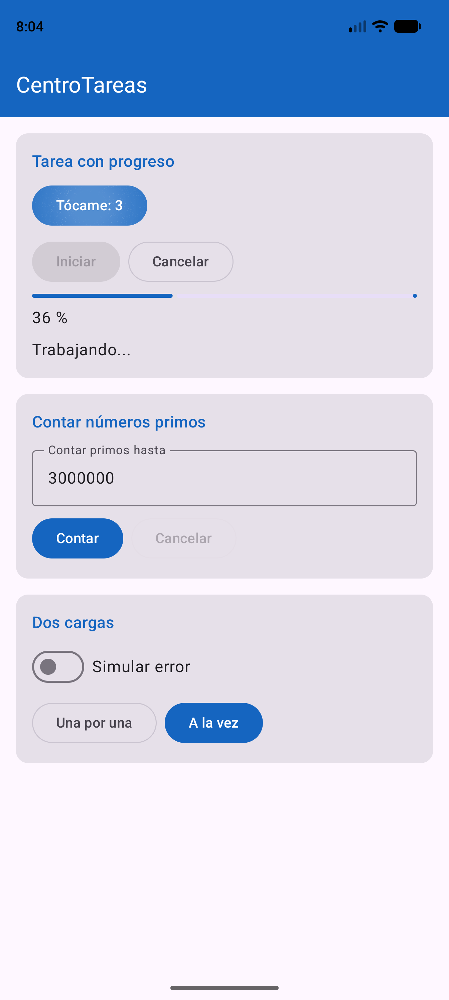
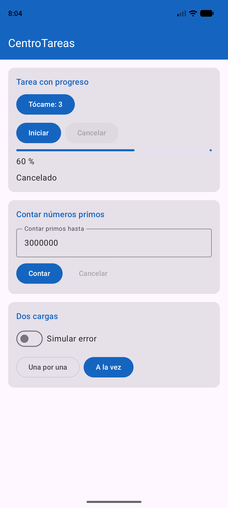
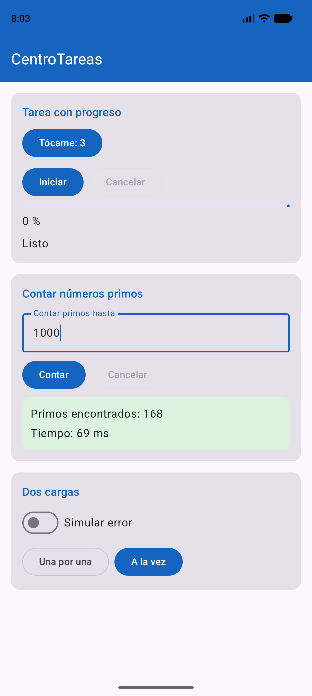
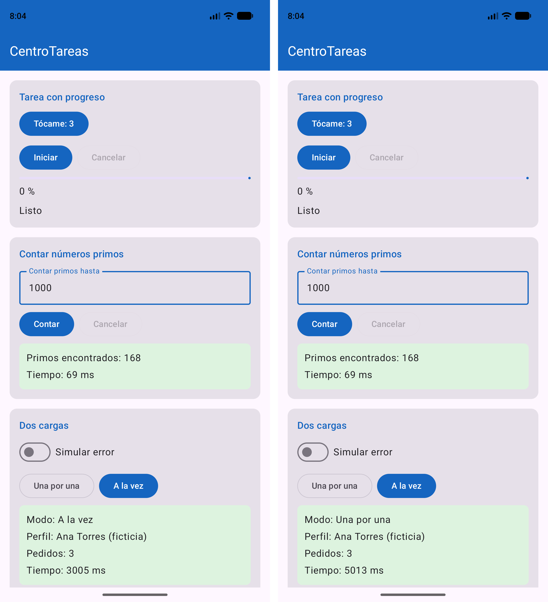
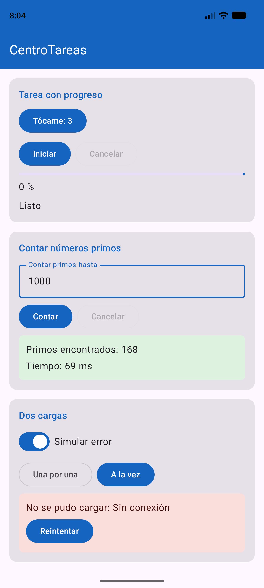

# CentroTareas

App de Android (Kotlin + Jetpack Compose + Material 3) que muestra cómo **no congelar nunca la pantalla**: una tarea con barra de progreso, un cálculo pesado (contar números primos) y dos cargas de datos simuladas. Usa corrutinas, `viewModelScope`, `StateFlow` y el patrón **MVVM + Repository**. Todos los datos son ficticios.

## Árbol de paquetes

```
com.flores.centrotareas
├── MainActivity.kt
├── model/        Estados.kt            (PrimosUi, CargaUi)
├── data/         TareasRepository.kt   (interface)
│                 TareasRepositoryLocal.kt (cargas simuladas y contar primos)
├── viewmodel/    TareasViewModel.kt
│                 TareasViewModelFactory.kt
└── ui/           PantallaTareas.kt     (las tres tarjetas)
    └── theme/
```

## Arquitectura MVVM + Repository

```
View (PantallaTareas)
   | eventos: botones               ^ collectAsState()
   v                                |
ViewModel (TareasViewModel) --- StateFlow --->
   | viewModelScope.launch { ... }
   v
TareasRepository (interface) ---> TareasRepositoryLocal
                                  (cargas simuladas y contar primos)
```

## Observación del Paso 1

Al tocar **Tarea larga (MAL)** la pantalla queda congelada 4 segundos: el botón *Tócame* no suma y nada responde. El texto *Trabajando...* nunca llega a verse porque `Thread.sleep(4000)` bloquea el hilo principal, que es el mismo que dibuja la pantalla; el cambio de `mensaje` se anota, pero Compose no puede redibujar hasta que el hilo quede libre, y para entonces ya dice *Terminó*. Si la espera fuera de 10 segundos, Android mostraría el diálogo **«La aplicación no responde» (ANR)** y ofrecería cerrarla.

## Capturas

| Captura | Archivo |
|---|---|
| Tarea con progreso | `capturas/progreso.png` |
| Tarea cancelada | `capturas/cancelada.png` |
| Primos | `capturas/primos.png` |
| Una por una contra a la vez | `capturas/cargas.png` |
| Error y Reintentar | `capturas/error.png` |







## Para pensar

1. **¿Por qué no se veía *Trabajando...* en el Paso 1?** Porque `Thread.sleep` detiene el hilo principal, que es el que dibuja. El mensaje cambia pero no hay ningún cuadro de pantalla hasta que termina la espera.
2. **¿Diferencia entre `Thread.sleep` y `delay`?** `Thread.sleep` bloquea el hilo completo. `delay` es una función `suspend`: suspende solo la corrutina, libera el hilo para otras tareas y revisa si fue cancelada.
3. **¿Por qué `Dispatchers.Default` para los primos y `Dispatchers.IO` para la red?** `Default` tiene tantos hilos como núcleos y sirve para cálculo que usa CPU. `IO` tiene un grupo grande de hilos pensado para tareas que esperan (red, disco) sin gastar CPU.
4. **¿Qué pasa con la corrutina si el usuario cierra la pantalla?** `viewModelScope` se cancela cuando el ViewModel se destruye (al salir de la pantalla de forma definitiva), así que las corrutinas se cancelan solas y no quedan trabajando para nada. Al rotar, el ViewModel sobrevive y la tarea continúa.
5. **¿Por qué `async` tarda 3 s y no 5 s?** Porque las dos cargas corren al mismo tiempo y se espera a la más lenta: máximo(2 s, 3 s) = 3 s. Si una falla, `coroutineScope` cancela a la otra y propaga la excepción, que el `try/catch` convierte en el estado de error.
