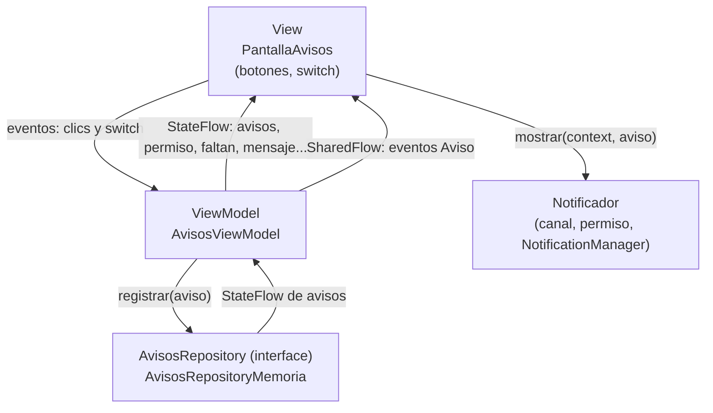
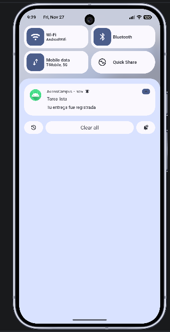
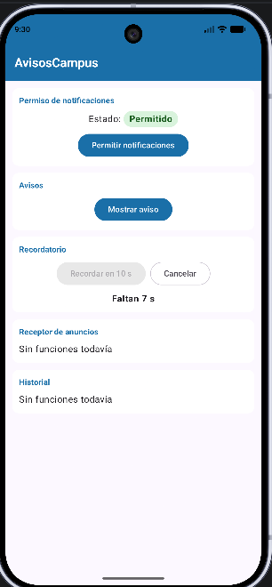
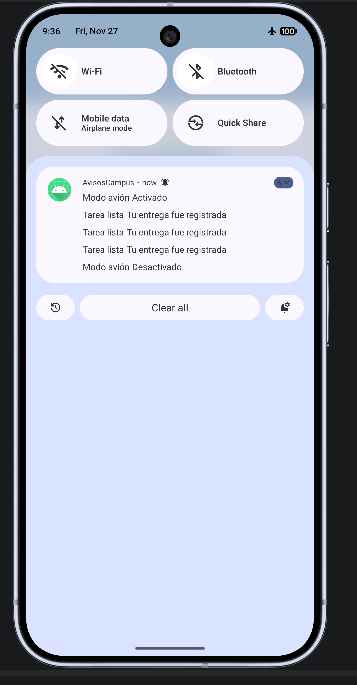
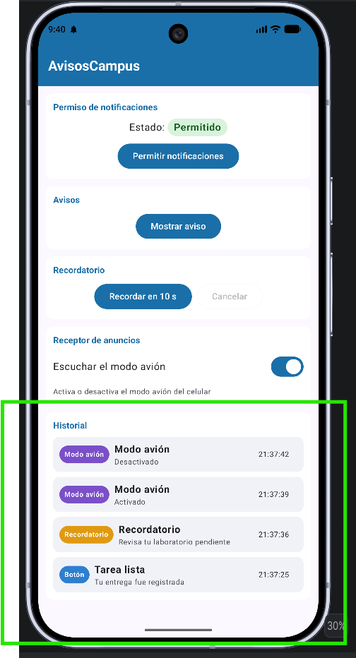
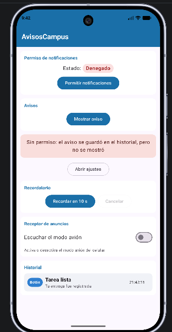

# AvisosCampus

App Android que **muestra notificaciones y escucha lo que pasa en el celular**. Con un botón muestra un aviso, con otro programa un recordatorio que llega a los 10 segundos, avisa cuando el usuario activa o desactiva el modo avión y deja todo anotado en un historial. Si el usuario niega el permiso, la app sigue funcionando y le permite corregirlo desde Ajustes.

- **Tecnología:** Kotlin + Jetpack Compose + Material 3 (sin XML), notificaciones locales y `BroadcastReceiver`.
- **Patrón:** MVVM + Repository (interface).
- **Autora:** Flores Quispe Yoselin Fabiola, ciclo 4 C24-C, Tecsup Santa Anita.
- **Datos:** solo ficticios. No usa internet ni claves.

## Estructura de paquetes

```
com.flores.avisoscampus/
├── AvisosApp.kt                 Application: crea el canal "Avisos" una sola vez
├── MainActivity.kt              Arma el ViewModel y muestra PantallaAvisos
├── model/
│   └── Modelos.kt               Aviso, Origen, PermisoUi
├── data/
│   └── AvisosRepository.kt      interface + AvisosRepositoryMemoria (historial)
├── notificacion/
│   └── Notificador.kt           canal, permiso y mostrar (NotificationCompat + PendingIntent)
├── receiver/
│   └── ModoAvionReceiver.kt     BroadcastReceiver del modo avión
├── viewmodel/
│   ├── AvisosViewModel.kt       estados y decisiones (sin Context)
│   └── AvisosViewModelFactory.kt
└── ui/
    ├── PantallaAvisos.kt        las tarjetas, el permiso y el registro del receptor
    ├── HistorialAvisos.kt       tarjeta del historial
    └── theme/                   Color, Theme, Type
```

## Diagrama MVVM



| Capa | Conoce a | No debe |
|---|---|---|
| View (`ui/`) | Solo a su ViewModel y al `Notificador` | Decidir qué se avisa ni guardar el historial |
| ViewModel | Solo a la interface del Repository | Usar `Context`, `NotificationManager` ni `BroadcastReceiver` |
| Repository | Nada de la UI | Usar `Context` |
| Notificador | El sistema (canal, `NotificationManager`) | Guardar estado de la app |

El ViewModel decide qué avisar y lo anota en el Repository. Después emite un evento; la pantalla lo recibe y, como sí tiene `Context`, llama al `Notificador`.

## Capturas

**1. Notificación en el panel**



**2. Recordatorio con cuenta regresiva**



**3. Modo avión**



**4. Historial de avisos**



**5. Permiso denegado**



## Para pensar

**1. ¿Por qué una notificación necesita un canal y un permiso? ¿Qué pasa si falta cada uno?**
El canal (Android 8+) agrupa las notificaciones y permite al usuario controlarlas por tipo (sonido, importancia). Si falta, la notificación no se muestra, porque Android la descarta. El permiso `POST_NOTIFICATIONS` (Android 13+) es la autorización explícita del usuario. Si falta o fue negado, `notify` no muestra nada, por eso `Notificador.mostrar` devuelve `false` y la app avisa con un mensaje.

**2. ¿Por qué el ViewModel emite un evento y no muestra la notificación él mismo?**
Porque mostrar una notificación necesita `Context` y `NotificationManager`, y el ViewModel no debe tenerlos: sobrevive a la rotación y tendría una referencia a una pantalla que ya no existe (fuga de memoria). Con el evento, el ViewModel solo decide y registra; la pantalla, que sí tiene `Context`, muestra la notificación. Así el ViewModel se puede probar sin Android.

**3. ¿Qué pasa si usas el mismo id en dos notificaciones?**
La segunda reemplaza a la primera: solo se ve una. Por eso se usa `aviso.id` en `notify`, que es distinto para cada aviso, y al pulsar dos veces aparecen dos notificaciones.

**4. ¿Por qué `onReceive` debe ser corto y por qué hay que quitar el receptor al salir?**
`onReceive` se ejecuta en el hilo principal y Android espera que termine rápido; si tarda, la app se congela o el sistema la cierra. Por eso solo avisa al ViewModel. El receptor hay que quitarlo (`unregisterReceiver` en `onDispose`) porque, si no, queda registrado después de que la pantalla desaparece: se filtra memoria y puede seguir recibiendo avisos sin que nadie los use.

**5. ¿En qué casos usarías una notificación local y en cuáles una push de Firebase?**
La **local** sirve cuando el aviso nace dentro del celular: un recordatorio programado, el resultado de una tarea, un cambio del sistema como el modo avión. No necesita internet. La **push de Firebase** sirve cuando el aviso viene de un servidor y la app puede estar cerrada: un mensaje nuevo, una noticia, un cambio de estado de un pedido.
